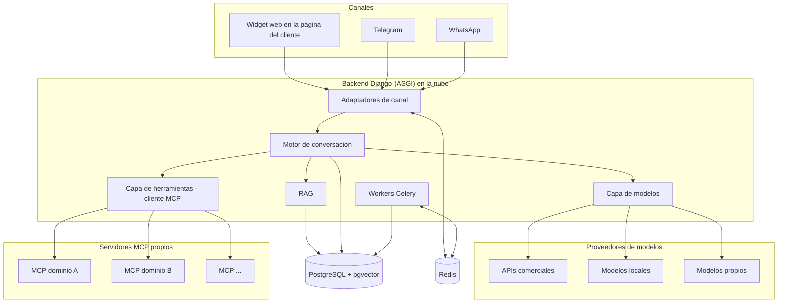

# Arquitectura del chatbot multicanal

## 1. Resumen ejecutivo

Se propone construir un chatbot propio, independiente del canal y del modelo de IA. El canal principal es un **widget embebible** que el cliente instala en su página web y que se comunica directamente con nuestro backend en la nube. Por separado, el mismo chatbot estará disponible en canales de mensajería como **Telegram** y **WhatsApp**, y la arquitectura permitirá añadir otros en el futuro. El chatbot podrá usar cualquier modelo de lenguaje: comercial (OpenAI, Anthropic, Google), local o gratuito (Ollama, vLLM) o propio de la empresa.

El sistema se construye sobre el stack estándar del equipo: **Python, Django (modo ASGI), PostgreSQL con pgvector, Redis y Celery**. La única pieza fuera de Python es el widget web, que necesariamente se escribe en TypeScript porque se ejecuta en el navegador del visitante.

El chatbot podrá responder con información propia de la empresa mediante **RAG** (recuperación sobre documentos internos) y ejecutar acciones exclusivamente a través de **herramientas MCP** (Model Context Protocol) expuestas por servidores MCP desarrollados por el equipo.

Los clientes son empresas que manejan datos sensibles. Por ello, el sistema es **multi-cliente con aislamiento estricto**: cada cliente dispone de su propio chatbot, con su propia configuración, modelo, base de conocimiento, canales, herramientas MCP y conversaciones, y **ningún dato se comparte entre clientes**. El código es común; los datos nunca lo son.

El principio de diseño central es que **el núcleo de conversación no conoce ni el canal de origen ni el modelo que responde**. Todo entra y sale por formatos internos normalizados, y la traducción a cada canal y a cada proveedor de modelos vive en **adaptadores intercambiables**.

---

## 2. Requisitos

### 2.1 Funcionales

- **RF-01. Widget web:** el chatbot debe poder integrarse en la página web de cualquier cliente mediante un fragmento de código. Es el canal principal.
- **RF-02. Canales de mensajería:** de forma independiente al widget, el chatbot debe estar disponible en Telegram y WhatsApp, y la arquitectura debe permitir añadir otros canales mediante nuevos adaptadores sin modificar el núcleo.
- **RF-03. Modelos intercambiables:** el chatbot debe poder funcionar con cualquier modelo de lenguaje (comercial, empresarial, gratuito o local). Cada cliente elige su modelo, y este debe poder cambiarse por configuración, sin modificar código.
- **RF-04. Conocimiento de la empresa:** el chatbot debe responder con información de la empresa a partir de documentos subidos (PDFs y otros formatos).
- **RF-05. Herramientas MCP:** el chatbot solo podrá ejecutar acciones o consultar información externa a través de herramientas expuestas por servidores MCP. No tendrá acceso directo a bases de datos ni a otros sistemas internos.
- **RF-06. Configuración sin despliegue:** los administradores deben poder cambiar desde un panel de administración, para cada cliente, el modelo, el prompt de sistema, los documentos de la base de conocimiento, los canales activos y las herramientas MCP habilitadas, sin modificar código ni volver a desplegar el sistema.
- **RF-07. Streaming opcional por canal:** las respuestas deben poder mostrarse en streaming (token a token) en los canales que lo admitan, como el widget web. El streaming es una capacidad configurable por canal; en los canales que no lo admiten (por ejemplo, Telegram) la respuesta se envía completa.
- **RF-08. Multi-cliente:** el sistema debe dar servicio a múltiples empresas cliente. Cada cliente tiene su propio chatbot, con configuración, modelo, base de conocimiento, canales, herramientas MCP, usuarios administradores y conversaciones propios. Dar de alta un cliente nuevo no debe requerir cambios de código.

### 2.2 No funcionales

- **RNF-01. Independencia de proveedor:** cambiar de modelo no debe implicar cambios de código ni pérdida de la base de conocimiento.
- **RNF-02. Protección de la API pública:** el widget se ejecuta en el navegador de cada visitante y se comunica directamente con nuestro backend en la nube. Por tanto, la API que consume el widget es accesible desde internet, y cualquiera puede ver su dirección y su clave en el código de la página. Esta API debe protegerse contra abuso (uso masivo, uso desde webs no autorizadas, uso como proxy gratuito hacia modelos de pago), suplantación de usuarios e inyección de prompts.
- **RNF-03. Privacidad:** debe ser posible operar con modelos locales para datos sensibles, y la retención de conversaciones debe ser configurable.
- **RNF-04. Escalabilidad:** un mismo proceso del servidor debe sostener muchas conversaciones en streaming simultáneas.
- **RNF-05. Bajo impacto en webs de clientes:** el widget no debe ralentizar ni romper la página que lo aloja.
- **RNF-06. Observabilidad (monitorización y trazabilidad):** el sistema debe registrar, para cada mensaje, qué modelo respondió, cuántos tokens consumió, cuánto costó, cuánto tardó y qué herramientas MCP se llamaron. Esto permite controlar el gasto, detectar errores y lentitud, y auditar qué hizo el chatbot en cada conversación. Las métricas se desglosan por cliente.
- **RNF-07. Aislamiento entre clientes:** ningún dato de un cliente (documentos, vectores, conversaciones, configuración, credenciales, registros) puede ser accesible desde el contexto de otro cliente, ni por error de programación ni por manipulación del usuario. El aislamiento debe garantizarse en la capa de datos, no solo en el código de la aplicación.

---

## 3. Stack tecnológico

| Capa | Tecnología | Motivo |
|---|---|---|
| Backend | Python, Django en modo ASGI | Stack estándar del equipo; ASGI permite streaming y WebSockets |
| Tiempo real | Django Channels (WebSockets) o SSE | Streaming de respuestas al widget |
| Servidor de aplicación | Uvicorn (o Gunicorn con workers Uvicorn) | Programa que ejecuta Django en producción y atiende las conexiones HTTP/WebSocket; debe ser compatible con ASGI (ver nota) |
| Base de datos | PostgreSQL | Stack estándar del equipo |
| Multi-cliente | `django-tenants` (un esquema de PostgreSQL por cliente) | Aislamiento de datos en la capa de base de datos (ver sección 4.2) |
| Búsqueda vectorial | Extensión pgvector | Evita una base vectorial separada; permite combinar filtros SQL con búsqueda semántica |
| Caché, colas y mensajería | Redis | Capa de canales, broker de Celery, rate limiting, caché |
| Tareas en segundo plano | Celery + Celery Beat | Ingesta de documentos, mensajes de canales de mensajería, reintentos, tareas programadas |
| Extracción de documentos | Docling (principal), PyMuPDF / pdfplumber, OCR (Tesseract) | Extracción estructurada de PDFs heterogéneos y escaneados |
| Canales de mensajería | Bibliotecas por canal (ver sección 5.3) | Adaptadores intercambiables |
| Herramientas | SDK oficial de MCP para Python (FastMCP) | Cliente y servidores MCP en Python |
| Widget web | TypeScript, Preact / Lit / vanilla, compilado con Vite o esbuild | Única pieza que corre en el navegador; debe ser ligera |
| Administración | Django admin (MVP), panel propio (fase 2) | Configuración sin código |
| Despliegue | Docker | Un contenedor por servicio |

**Nota sobre el servidor de aplicación.** Django no es un servidor web por sí mismo: es un framework. El comando `runserver` solo sirve para desarrollo. En producción, Django se ejecuta dentro de un servidor de aplicación, que es el programa que escucha en un puerto, recibe las conexiones y se las entrega a Django. En proyectos WSGI tradicionales suele usarse Gunicorn; como este proyecto usa ASGI, se requiere un servidor compatible con ASGI, como Uvicorn. Delante suele colocarse un proxy inverso (por ejemplo, Nginx) que gestiona HTTPS y archivos estáticos.

---

## 4. Arquitectura general



### 4.1 Componentes

| Componente | Responsabilidad |
|---|---|
| Adaptadores de canal | Traducen mensajes de cada canal al formato interno y viceversa |
| Motor de conversación | Gestiona historial, prompt de sistema, contexto RAG y el bucle de herramientas |
| Capa de modelos | Interfaz única para cualquier proveedor de LLM |
| RAG | Recupera fragmentos relevantes de la base de conocimiento |
| Capa de herramientas | Cliente MCP: descubre e invoca herramientas de servidores MCP autorizados |
| Workers Celery | Ejecutan trabajo lento o fuera de banda |
| PostgreSQL + pgvector | Persistencia de configuración, conversaciones, documentos y vectores |
| Redis | Memoria compartida rápida entre procesos |

### 4.2 Modelo multi-cliente y aislamiento de datos

#### Concepto

Cada empresa cliente es un **inquilino** (*tenant*). Todos los inquilinos usan el mismo código y la misma infraestructura de aplicación, pero cada uno tiene un espacio de datos completamente separado. Toda petición se resuelve primero a un inquilino y, a partir de ahí, el sistema solo puede ver los datos de ese inquilino.

#### Un esquema de PostgreSQL por cliente

El aislamiento se implementa con **un esquema de PostgreSQL por cliente**, mediante `django-tenants`. Todos los clientes comparten la misma base de datos, pero cada uno tiene su propio esquema con sus propias tablas, de modo que las consultas realizadas en el contexto de un cliente no pueden alcanzar las tablas de otro, aunque exista un error en el código de la aplicación. `django-tenants` resuelve el cliente al inicio de cada petición y activa su esquema; las migraciones se aplican a cada esquema.

#### Estructura

- **Esquema público (compartido):** solo datos de gestión de la plataforma: tabla de clientes, dominios y claves de widget que permiten identificar a qué cliente pertenece una petición, y planes o límites. No contiene datos de negocio de ningún cliente.
- **Esquema de cada cliente:** configuración del chatbot, modelos y credenciales, canales, base de conocimiento (documentos, fragmentos y vectores con su propio índice pgvector), servidores MCP, conversaciones, mensajes, registros de herramientas y usuarios administradores del cliente.

#### Resolución del inquilino

| Origen de la petición | Cómo se identifica el cliente |
|---|---|
| Widget web | Clave pública del widget (`data-widget-key`), validada contra los dominios permitidos de ese cliente |
| Telegram / WhatsApp | URL de webhook única por cliente y canal, con secreto propio |
| Panel de administración | Usuario autenticado, que solo pertenece a un cliente (salvo los administradores de la plataforma) |
| Tareas Celery | Cada tarea lleva explícitamente el identificador del cliente y activa su esquema antes de ejecutarse |

#### Aislamiento más allá de la base de datos

- **Redis:** todas las claves (caché, rate limiting, sesiones) llevan el prefijo del cliente.
- **Archivos:** los documentos subidos se guardan en un almacenamiento separado por cliente (contenedor o prefijo propio, con permisos independientes).
- **Credenciales:** las claves de modelos, tokens de canales y tokens MCP de cada cliente se cifran con una clave de cifrado propia del cliente.
- **Modelos:** cada cliente configura su propio proveedor y sus propias credenciales. Un cliente puede exigir usar solo modelos locales; en ese caso, sus datos nunca salen hacia proveedores externos.
- **Registros:** los logs técnicos no incluyen el contenido de las conversaciones; se identifican por cliente y por identificadores internos.
- **Ciclo de vida:** al finalizar el contrato de un cliente, su esquema, sus archivos y sus claves se eliminan por completo (incluidas copias de seguridad según la política de retención acordada).
- **Pruebas automáticas de aislamiento:** el conjunto de tests incluye pruebas que intentan acceder a datos de un cliente desde el contexto de otro, y deben fallar siempre.

---

## 5. Canales y adaptadores intercambiables

### 5.1 Principio: formato interno normalizado

Todo mensaje entrante se convierte en un `IncomingMessage` interno (canal, identidad del usuario, texto, adjuntos, metadatos). Toda respuesta se genera como un `OutgoingMessage` interno (texto, botones, adjuntos) que el adaptador del canal traduce a las capacidades concretas de ese canal. Añadir un canal nuevo consiste en escribir un adaptador; el núcleo no se modifica.

### 5.2 Interfaz de adaptador

Cada canal implementa una interfaz común `ChannelAdapter`:

| Elemento | Función |
|---|---|
| `verify_request()` | Valida la firma o el secreto del canal en la petición entrante |
| `parse_incoming()` | Convierte la petición del canal en un `IncomingMessage` |
| `send()` | Convierte un `OutgoingMessage` al formato del canal y lo envía |
| `capabilities` | Declara qué admite el canal: streaming, longitud máxima, formato (Markdown/HTML), botones, adjuntos |

El motor de conversación consulta `capabilities` para decidir, por ejemplo, si responder en streaming o enviar la respuesta completa, y cómo dividir mensajes largos.

| Canal | Capacidades y particularidades |
|---|---|
| Widget web | Streaming; Markdown; botones |
| Telegram | Sin streaming nativo (se usa el indicador de "escribiendo"); límite de 4096 caracteres por mensaje; formato Markdown/HTML propio |
| WhatsApp (Cloud API) | Sin streaming; ventana de conversación de 24 horas; plantillas aprobadas para mensajes iniciados por la empresa; botones con límites propios |

### 5.3 Bibliotecas propuestas por canal (propuesta, pendiente de validación)

Las bibliotecas se usan **solo dentro del adaptador correspondiente**, como implementación de la interfaz `ChannelAdapter`. Los webhooks se reciben en vistas de Django; las bibliotecas se emplean para validar, interpretar y enviar mensajes. De este modo, cambiar de biblioteca no afecta al resto del sistema.

| Canal | Opción propuesta | Alternativas | Observaciones |
|---|---|---|---|
| Telegram | `python-telegram-bot` | `aiogram` | Ambas son asíncronas y maduras. Se usan en modo webhook, no en modo polling. |
| WhatsApp | `pywa` (sobre la Cloud API oficial de Meta) | SDK de Twilio (`twilio`), como proveedor intermediario oficial | PyWa es un framework Python tipado y con soporte asíncrono para la Cloud API. Twilio simplifica el alta y la facturación a cambio de un coste adicional por mensaje. |
| Slack (futuro) | `slack-bolt` | — | SDK oficial de Slack para Python. |
| Discord (futuro) | `discord.py` | — | — |
| Email (futuro) | `django-anymail` (webhooks de correo entrante) | — | Integración nativa con Django. |

> **Implementación actual:** WhatsApp se integró con un puente Node basado en Baileys (interfaz no oficial de WhatsApp Web), no con `pywa` ni la Cloud API. Telegram usa llamadas HTTP directas a la Bot API, sin biblioteca. Consulta [Telegram y WhatsApp con Baileys](canales-telegram-baileys.md). La Cloud API sigue siendo la opción prevista si Baileys no resulta estable para clientes.

### 5.4 Canales por cliente

Cada cliente conecta **sus propias cuentas** de canales: su propio bot de Telegram (con su token) y su propio número de WhatsApp Business. Ningún canal se comparte entre clientes. Cada canal de cada cliente tiene una URL de webhook única con un secreto propio, que permite resolver el cliente antes de procesar el mensaje.

En WhatsApp, conectar el número de cada cliente requiere que la empresa cliente tenga su propia cuenta de WhatsApp Business verificada por Meta. El proceso de alta de clientes en WhatsApp (gestión directa o mediante un proveedor intermediario) debe definirse (ver sección 19).

### 5.5 Canales con webhook (Telegram, WhatsApp)

Estos canales envían un webhook y esperan una respuesta HTTP rápida; si se retrasa, reintentan y duplican mensajes. Por ello:

1. La vista del webhook valida la firma o el secreto del canal (`verify_request()`), guarda el mensaje y **responde 200 inmediatamente**.
2. Encola una tarea Celery que genera la respuesta con el modelo y la envía mediante el adaptador (`send()`).
3. Se deduplica por identificador de mensaje del canal.

### 5.6 Widget web

#### Por qué TypeScript

El widget se ejecuta en el navegador del visitante, que solo ejecuta JavaScript y WebAssembly. Ejecutar Python en el navegador (Pyodide) supondría descargar varios megabytes, inaceptable para un widget cuyo objetivo es pesar entre 20 y 50 KB.

#### Integración

El cliente pega un único fragmento en su web:

```html
<script
  src="https://cdn.<dominio>/widget/v1/loader.js"
  data-widget-key="pk_live_xxxxxxxx"
  data-lang="es"
  async>
</script>
```

- **Carga asíncrona (`async`):** no bloquea la carga de la web del cliente; si nuestro servicio cae, su web sigue funcionando.
- **Loader mínimo:** lee la configuración de los atributos `data-`, inyecta el botón flotante y solo carga el chat completo cuando el usuario lo abre.
- **Comunicación directa con el backend:** el widget, ya en el navegador del visitante, se conecta directamente a nuestra API en la nube (HTTPS y WebSocket/SSE). La web del cliente no actúa como intermediaria.
- **Aislamiento:**
  - Botón flotante en **Shadow DOM** (integración visual, CSS encapsulado).
  - Ventana de chat en un **iframe** servido desde nuestro dominio (aislamiento total de CSS y JavaScript en ambos sentidos).
  - Comunicación entre página e iframe con `window.postMessage`.
- **API pública en `window`** (por ejemplo `open()`, `close()`, `identify()`) para que las webs SPA (React, Vue, Angular) lo controlen.
- **Versionado en la URL** (`/widget/v1/`): correcciones automáticas dentro de una versión mayor; los cambios incompatibles van a una versión nueva.
- **Responsive y accesible:** pantalla completa en móvil, navegación por teclado y etiquetas ARIA.

#### Seguridad del widget

La clave `data-widget-key` identifica al cliente y su sitio web, y es **pública** por definición, ya que es visible en el código de la página. La protección se basa en:

- **Lista de dominios permitidos por clave** y validación de la cabecera `Origin` en el backend.
- **Token de sesión de corta duración** emitido al abrir el chat; los mensajes se autentican con él, no con la clave.
- **Rate limiting** por IP y por sesión (Redis).
- **Límite de tokens** por conversación y por mensaje.
- **Identificación de usuarios autenticados:** si la web del cliente quiere identificar al usuario, su **servidor** firma la identidad (JWT o HMAC con un secreto emitido desde nuestro panel de administración) y el widget transmite la firma. El backend verifica la firma antes de confiar en la identidad. Nunca se acepta un identificador de usuario en texto plano.
- **No depender de cookies de terceros** (bloqueadas o particionadas por los navegadores actuales).
- **Documentación de CSP** para clientes: dominios a añadir en `script-src`, `frame-src` y `connect-src`.

---

## 6. Backend en modo ASGI

Django se ejecuta como aplicación **ASGI** en lugar de WSGI. En WSGI cada petición ocupa un worker durante toda su duración; una respuesta de un LLM puede tardar decenas de segundos, por lo que cada usuario en streaming bloquearía un worker. En ASGI, basado en `asyncio`, un mismo proceso atiende muchas conexiones mientras esperan a la red.

- Las rutas de chat (streaming y WebSockets) son **asíncronas**.
- El resto (administración, CRUD) puede seguir siendo síncrono; Django lo ejecuta en hilos.
- **Normas de código:**
  - Dentro de código asíncrono no se usan librerías bloqueantes (se usa `httpx`, no `requests`).
  - El acceso al ORM desde código asíncrono usa los métodos async (`aget`, `afilter`, etc.) o `sync_to_async`.
- **Django Channels** gestiona los WebSockets; su capa de canales usa Redis para comunicar procesos entre sí.
- El backend se sirve con un servidor de aplicación ASGI (Uvicorn) detrás de un proxy inverso.

---

## 7. Motor de conversación

Responsable de orquestar cada turno:

1. Cargar la configuración del chatbot (cacheada en Redis).
2. Recuperar el historial de la conversación (con límite de turnos o tokens; resumen automático de historiales largos).
3. Si el RAG está activo, recuperar fragmentos relevantes.
4. Obtener la lista de herramientas MCP autorizadas para el canal y el tipo de usuario (anónimo o identificado).
5. Construir el prompt (sistema + contexto RAG + historial + mensaje).
6. Llamar al modelo mediante la capa de modelos, en streaming o no según las capacidades del canal.
7. **Bucle de herramientas:** si el modelo solicita una herramienta, ejecutarla a través del cliente MCP, devolver el resultado al modelo y repetir hasta obtener una respuesta final (con límite de iteraciones).
8. Persistir el turno y emitir la respuesta al adaptador de canal.

El bucle de herramientas forma parte del motor **desde el MVP**, aunque inicialmente haya pocas herramientas, para no tener que reestructurar el flujo más adelante.

---

## 8. Capa de modelos

### 8.1 Interfaz propia

Se define una interfaz interna `LLMProvider`:

- `chat(mensajes, herramientas, opciones)`
- `stream(mensajes, herramientas, opciones)`
- `embed(textos)` (en proveedores que lo soporten)
- `capabilities` (declaración de capacidades)

Implementaciones previstas:

| Adaptador | Cubre |
|---|---|
| OpenAI-compatible | OpenAI, Azure OpenAI, OpenRouter, Ollama, vLLM, LM Studio y cualquier servidor que exponga el formato de OpenAI |
| Anthropic | Modelos Claude (API nativa) |
| Google | Modelos Gemini (API nativa) |
| Personalizado | Modelos propios con API no estándar |

La configuración (proveedor, modelo, URL base, parámetros) se guarda en PostgreSQL y se modifica desde el panel de administración; las API keys se almacenan **cifradas**.

### 8.2 Declaración de capacidades

Cada proveedor/modelo declara: soporte de tool calling, streaming, visión, tamaño de contexto y salida estructurada. El sistema:

- Impide (o advierte en el panel) combinaciones inválidas, por ejemplo herramientas MCP activas con un modelo sin tool calling.
- Ajusta el tamaño del historial y del contexto RAG al contexto disponible del modelo.

### 8.3 Fallback

Opcionalmente, se puede definir un modelo de respaldo para errores o indisponibilidad del principal.

### 8.4 Uso de librerías de terceros (LiteLLM)

LiteLLM ofrece una interfaz unificada para más de 100 proveedores y puede usarse como **una implementación detrás de `LLMProvider`**, nunca como dependencia directa del núcleo. En marzo de 2026 el paquete sufrió un compromiso en PyPI (versiones 1.82.7 y 1.82.8 publicadas con código malicioso que robaba credenciales). Dado que este tipo de librería maneja las claves de todos los proveedores, si se adopta:

- Versión fijada exactamente, con verificación de hash.
- Revisión antes de cada actualización.
- Sustituible sin afectar al resto del sistema.

Esta norma de dependencias aplica a todo el proyecto, incluidas las bibliotecas de canales (ver sección 13).

---

## 9. RAG y base de conocimiento

### 9.1 Propósito

Los modelos no conocen la información de la empresa. RAG recupera fragmentos relevantes de los documentos internos y los incluye en el prompt para que el modelo responda con datos reales y sin inventar.

Alternativas descartadas:

| Alternativa | Motivo del descarte |
|---|---|
| Fine-tuning | Caro, lento de actualizar, poco fiable para datos concretos y ata el conocimiento a un modelo |
| Enviar todos los documentos en cada prompt | Coste y latencia muy altos; no cabe en modelos locales de contexto pequeño; peor precisión |
| Búsqueda en archivos del proveedor | El conocimiento queda en la plataforma del proveedor y solo sirve con sus modelos |

Con RAG propio **el conocimiento pertenece a la empresa y lo puede usar cualquier modelo**.

### 9.2 Reparto de funciones

- **Modelo de embeddings:** convierte texto en vectores que representan su significado. No almacena nada.
- **pgvector:** almacena los vectores en PostgreSQL (columna `vector`), calcula distancias (`<=>` coseno) e indexa (HNSW) para encontrar los más cercanos en milisegundos. Permite combinar la búsqueda semántica con filtros SQL (base de conocimiento, documento activo) en una sola consulta.

### 9.3 Pipeline de ingesta (Celery)

1. **Extracción:** Docling como herramienta principal (preserva títulos, secciones, tablas y listas). Detección automática de páginas sin texto y aplicación de OCR solo en ellas.
2. **Limpieza:** eliminación de encabezados y pies repetidos, números de página, guiones de corte; normalización de codificación; deduplicación por hash del texto limpio.
3. **Troceado (chunking):** respetando la estructura (sección → párrafo); fragmentos de 300 a 800 tokens con un solapamiento del 10–15 %; tablas como unidades completas o por filas con encabezados repetidos.
4. **Enriquecimiento contextual:** se antepone a cada fragmento su contexto (`Documento > Sección`) antes de generar el embedding. Opcionalmente, un LLM genera una frase de contexto por fragmento.
5. **Metadatos:** documento, página, sección, versión, fecha.
6. **Embeddings e indexación:** generación por lotes e índice HNSW.
7. **Estado del documento** visible en el panel: pendiente, procesando, listo, error.

### 9.4 Recuperación

- Búsqueda **híbrida**: vectorial (pgvector) + texto completo de PostgreSQL, para cubrir nombres propios, códigos y referencias exactas.
- Recuperación de los 3–5 fragmentos más relevantes.
- Inclusión de la fuente en la respuesta cuando proceda ("según el Manual X, página 12").

### 9.5 Reglas

- **El modelo de embeddings es fijo por base de conocimiento.** Los vectores de modelos distintos no son compatibles; cambiarlo implica reindexar (tarea Celery). Se registra qué modelo generó cada vector.
- El RAG puede activarse o desactivarse desde el panel.
- Se mantiene un **conjunto de evaluación** de 30–50 preguntas reales con su respuesta y documento esperados, ejecutado ante cualquier cambio del pipeline (extractor, tamaño de fragmento, modelo de embeddings).

---

## 10. Herramientas mediante MCP

### 10.1 Propósito y alcance

MCP (Model Context Protocol) es el estándar abierto para conectar aplicaciones de IA con herramientas y datos. Es el **único mecanismo** por el que el chatbot puede consultar información externa o ejecutar acciones (RF-05). El chatbot no accede directamente a bases de datos ni a otros sistemas internos: si en el futuro se necesita acceder a un sistema, se hará exponiendo una herramienta en un servidor MCP.

Papeles:

- **Host y cliente MCP:** el backend Django.
- **Servidores MCP:** servicios desarrollados por el equipo, uno por dominio de negocio.

Los servidores MCP se configuran **por cliente**: cada cliente solo tiene acceso a los servidores y herramientas habilitados en su esquema. Un servidor MCP que dé servicio a varios clientes debe recibir el identificador del cliente desde el backend (nunca desde el modelo) y aislar sus datos por cliente con el mismo rigor que el backend.

MCP no sustituye a los canales, a la capa de modelos ni al RAG.

### 10.2 Servidores MCP propios

Se implementan servidores MCP propios con el SDK oficial de Python (FastMCP) y transporte **Streamable HTTP**. Cada servidor:

- Es un servicio independiente, con su propio contenedor, URL y equipo responsable.
- Expone **un único endpoint MCP** (por ejemplo `https://mcp-<dominio>.interno/mcp`) que declara sus herramientas.
- Es preferiblemente **sin estado**, para escalar con réplicas.

Los servidores MCP concretos y sus herramientas se definirán en función de las necesidades del negocio (ver sección 19).

### 10.3 Diseño de herramientas

- Pocas herramientas por servidor, pensadas para el modelo, no una por cada endpoint de una API existente.
- Nombres claros, descripciones precisas y parámetros tipados.
- Respuestas reducidas a los campos útiles.
- Separación explícita entre herramientas de **lectura** y de **escritura**.

### 10.4 Interfaz unificada de herramientas

El motor de conversación trabaja con una interfaz única de herramientas. Aunque el alcance actual se limita a herramientas MCP, esta interfaz evita acoplar el motor a un servidor concreto y permite añadir o retirar servidores desde el panel sin tocar el núcleo.

### 10.5 Autenticación y autorización

Dos niveles, que no deben mezclarse:

1. **Servicio que llama:** los servidores MCP solo aceptan peticiones del backend del chatbot.
   - Despliegue en red interna, nunca expuestos a internet.
   - Token de servicio por servidor y por cliente.
2. **Usuario final:** el backend inyecta la **identidad verificada** del usuario en cada llamada, fuera del alcance del modelo. El servidor MCP filtra los datos por esa identidad en código. **Nunca** se confía en un identificador de usuario pasado por el modelo como argumento.

Reglas adicionales:

- Los usuarios anónimos no acceden a herramientas que devuelvan datos personales.
- Las herramientas de escritura requieren **confirmación explícita** del usuario antes de ejecutarse.
- Las herramientas permitidas se configuran en el panel por canal y por tipo de usuario (anónimo o identificado).
- Solo se habilitan servidores MCP de terceros tras revisión.
- Límite de llamadas a herramientas por mensaje y timeouts.

### 10.6 Versionado y registro

- Las herramientas se tratan como API pública: añadir es compatible; renombrar, cambiar parámetros o eliminar requiere nueva versión.
- Registro en ambos lados (backend y servidor MCP): usuario, canal, herramienta, argumentos, resultado, duración.

---

## 11. Redis y Celery

### 11.1 Redis

| Uso | Descripción |
|---|---|
| Capa de canales | Comunicación entre procesos de Django Channels (necesaria con más de un proceso) |
| Broker de Celery | Cola de tareas |
| Rate limiting | Contadores por IP/sesión con caducidad automática |
| Caché | Configuración del chatbot, sesiones activas, respuestas repetidas |

Redis **no** almacena datos de negocio a largo plazo; la fuente de verdad es PostgreSQL.

### 11.2 Celery

| Tarea | Descripción |
|---|---|
| Ingesta RAG | Extracción, troceado, embeddings e indexación de documentos |
| Mensajes de canales con webhook | Generación y envío de respuestas de Telegram, WhatsApp, etc. |
| Reintentos | Reintentos con espera creciente ante fallos de APIs externas |
| Reindexación | Cambio de modelo de embeddings o de estrategia de troceado |
| Tareas programadas (Beat) | Retención y borrado de conversaciones, informes de uso y coste |

**El streaming del widget no pasa por Celery:** la vista ASGI llama directamente al modelo y envía los tokens por la conexión abierta. Celery es para el trabajo fuera de banda; ASGI para lo que el usuario está viendo en directo.

---

## 12. Modelo de datos (resumen)

**Esquema público (compartido):**

| Entidad | Campos principales |
|---|---|
| `Cliente` | Nombre, nombre de esquema, estado, plan y límites |
| `DominioCliente` | Cliente, dominio, clave pública de widget (para resolver el inquilino) |
| `AdminPlataforma` | Usuarios administradores de la plataforma (no acceden a datos de negocio de los clientes) |

**Esquema de cada cliente** (las mismas tablas, repetidas y aisladas en cada esquema):

| Entidad | Campos principales |
|---|---|
| `ConfigChatbot` | Prompt de sistema, modelo principal, modelo de respaldo, RAG activo, límites, política de retención |
| `ConfigModelo` | Proveedor, modelo, URL base, API key cifrada, parámetros, capacidades |
| `Canal` | Tipo (web, telegram, whatsapp...), credenciales cifradas, streaming activo, estado |
| `SitioWidget` | Clave pública, dominios permitidos, secreto de firma de identidad, estado |
| `UsuarioAdmin` | Administradores del cliente en el panel |
| `Conversacion` | Canal, sitio (si es widget), identidad de usuario (verificada o anónima), fechas |
| `Mensaje` | Conversación, rol, contenido, tokens, coste, latencia, modelo usado |
| `BaseConocimiento` | Modelo de embeddings (fijo) |
| `Documento` | Base de conocimiento, archivo, hash, versión, estado |
| `Fragmento` | Documento, texto, texto enriquecido, `embedding` (vector), página, sección |
| `ServidorMCP` | URL, token de servicio cifrado, estado |
| `PermisoHerramienta` | Servidor MCP, herramienta, canal, tipo de usuario permitido, lectura/escritura, requiere confirmación |
| `LlamadaHerramienta` | Mensaje, herramienta, argumentos, resultado, duración, error |

---

## 13. Seguridad y privacidad

- **Aislamiento entre clientes:** esquema de PostgreSQL por cliente, prefijos en Redis, almacenamiento de archivos separado y pruebas automáticas de aislamiento (sección 4.2).
- **Secretos:** API keys, tokens de canales y de servidores MCP cifrados en base de datos con una clave de cifrado por cliente; nunca en el código ni en logs.
- **Acceso del personal de la plataforma:** los administradores de la plataforma gestionan clientes, pero no consultan conversaciones ni documentos de un cliente salvo autorización expresa, y todo acceso queda registrado.
- **Cumplimiento normativo:** al tratarse de datos de empresas con información sensible, el tratamiento debe ajustarse a la normativa de protección de datos aplicable (por ejemplo, el RGPD para clientes en la UE), incluyendo contratos de encargado del tratamiento con cada cliente y con los proveedores de modelos externos.
- **Dependencias:** versiones fijadas con hash (`pip --require-hashes` o equivalente), revisión de actualizaciones, especial cuidado con librerías que manejan credenciales.
- **Inyección de prompts:** los permisos se aplican en código, nunca en el prompt. El chatbot no tiene acceso a datos que no puedan mostrarse al usuario que conversa.
- **Protección de la API del widget:** dominios permitidos, rate limiting, tokens de sesión, límites de tokens.
- **Privacidad:**
  - Retención de conversaciones configurable, con borrado automático.
  - Posibilidad de que cada cliente use exclusivamente modelos locales.
  - Cifrado en reposo de base de datos, archivos y copias de seguridad, y cifrado en tránsito (TLS) en todas las conexiones.
  - Registro de a qué proveedor externo se envían datos.
- **Red:** servidores MCP, PostgreSQL y Redis solo accesibles desde la red interna.

---

## 14. Observabilidad

- Por mensaje: canal, modelo, tokens de entrada y salida, coste estimado, latencia, fragmentos RAG usados, herramientas MCP invocadas.
- Paneles de uso y coste por cliente, por canal y por sitio web.
- Registro de errores por proveedor de modelos y por canal.
- Integración opcional con herramientas de trazabilidad de LLM (por ejemplo, Langfuse, autoalojable).
- Ejecución periódica del conjunto de evaluación del RAG.

---

## 15. Despliegue

Servicios en contenedores Docker:

| Servicio | Réplicas |
|---|---|
| Proxy inverso (Nginx) | Una o más |
| Backend Django (Uvicorn) | Varias, detrás del proxy |
| Workers Celery | Escalables según carga de ingesta y canales |
| Celery Beat | Una |
| PostgreSQL con pgvector | Una principal (réplicas de lectura si se requiere) |
| Redis | Una (alta disponibilidad si se requiere) |
| Servidores MCP | Uno por dominio, escalables |
| Widget | Archivos estáticos en CDN o servidor estático |
| Modelos locales (opcional) | Ollama o vLLM en servidor con GPU |

---

## 16. Plan de fases

Las duraciones son estimaciones a validar con el equipo.

### Fase 1 – MVP (aprox. 4–6 semanas)

- Núcleo: interfaz de adaptadores de canal, motor de conversación **con bucle de herramientas**, capa de modelos.
- Canales: widget web con streaming y Telegram.
- Modelos: un proveedor comercial y uno local (Ollama).
- RAG básico: Docling, troceado por secciones con contexto, pgvector, búsqueda híbrida, conjunto de evaluación.
- MCP: uno o dos servidores propios con herramientas de **solo lectura**.
- Multi-cliente con un esquema por cliente desde el primer día, incluidas las pruebas de aislamiento.
- Seguridad de la API del widget completa (dominios, tokens, rate limiting).
- Administración con Django admin, separando administradores de plataforma y de cliente.

### Fase 2

- WhatsApp (Cloud API oficial).
- Herramientas MCP de escritura con confirmación.
- Traspaso de conversación a un agente humano.
- Analítica de uso y coste; panel de administración propio.

### Fase 3

- Canales adicionales (Slack, Discord, email u otros, según demanda).
- Servidores MCP de terceros revisados.

---

## 17. Proyectos de referencia

| Proyecto | Lenguaje | Qué estudiar |
|---|---|---|
| Rasa | Python | Abstracción de canales y conectores (Telegram, webchat) |
| AstrBot | Python | Capa multiplataforma y soporte de múltiples proveedores de modelos |
| Chatwoot | Ruby on Rails | Widget embebible maduro (loader, iframe, identificación), traspaso a humano |
| Tiledesk | Node.js | Respuestas definidas una vez y adaptadas a cada canal |
| Dify / Flowise | Python / Node.js | Configuración del chatbot, widget embebible, multi-modelo |
| LiteLLM | Python | Capa de abstracción de proveedores (con las precauciones de la sección 8.4) |

**Construir frente a adoptar:** plataformas como Dify o Chatwoot cubren parte de la funcionalidad. Se propone construir para obtener control total, integración mediante servidores MCP propios, uso del stack del equipo y ausencia de dependencias de licencias de terceros (las condiciones de uso multi-tenant de algunas de estas plataformas deben revisarse si se reconsiderara).

---

## 18. Riesgos

| Riesgo | Impacto | Mitigación |
|---|---|---|
| Fuga de datos entre clientes | Crítico (legal y reputacional) | Esquema por cliente, prefijos en Redis, almacenamiento separado, cifrado por cliente, pruebas automáticas de aislamiento |
| Abuso de la API del widget como proxy de modelos de pago | Coste | Dominios permitidos, rate limiting, límites de tokens, tokens de sesión |
| Inyección de prompts que provoca uso indebido de herramientas | Fuga de datos | Permisos en código, identidad inyectada por el backend, confirmación en escritura |
| Modelos locales sin tool calling fiable | Funcionalidad | Declaración de capacidades y validación en el panel |
| PDFs de baja calidad | Respuestas incorrectas | Pipeline de extracción robusto, OCR, conjunto de evaluación |
| Compromiso de dependencias | Robo de credenciales | Versiones fijadas con hash, revisión, interfaces propias sustituibles |
| Cambios en APIs o políticas de canales externos | Interrupción de canal | Adaptadores aislados, monitorización de errores por canal |
| Envío de datos sensibles a proveedores externos | Privacidad / cumplimiento | Modelos locales, política de retención |

---

## 19. Decisiones pendientes de revisión

1. Proceso de alta de clientes en WhatsApp (gestión directa de sus cuentas de Meta o mediante proveedor intermediario).
2. Ubicación geográfica de los datos (región del proveedor en la nube) y requisitos normativos de los clientes.
3. Servidores MCP y herramientas a desarrollar para el MVP.
4. WebSockets (Django Channels) frente a SSE para el streaming del widget.
5. Biblioteca de Telegram: `python-telegram-bot` o `aiogram`.
6. WhatsApp: Cloud API directa con `pywa` o a través de un proveedor intermediario (Twilio).
7. Proveedores de modelos concretos del MVP (comercial y local).
8. Modelo de embeddings para la base de conocimiento.
9. Adopción o no de LiteLLM como implementación de la capa de modelos.
10. Política de retención de conversaciones por defecto.
11. Infraestructura para modelos locales (servidor con GPU propio o externo).
12. Framework del widget: Preact, Lit o vanilla TypeScript.

---

## 20. Glosario

| Término | Definición |
|---|---|
| ASGI | Interfaz asíncrona entre servidor de aplicación y Django; permite streaming y WebSockets con muchas conexiones por proceso |
| WSGI | Interfaz síncrona tradicional; un worker por petición |
| Servidor de aplicación | Programa que ejecuta Django en producción y le entrega las conexiones entrantes (Uvicorn, Gunicorn) |
| Proxy inverso | Servidor delante de la aplicación que gestiona HTTPS, archivos estáticos y reparto de carga (Nginx) |
| Inquilino (*tenant*) | Cada empresa cliente, con su espacio de datos aislado dentro de la plataforma |
| Esquema de PostgreSQL | Espacio de nombres dentro de una base de datos con sus propias tablas; se usa uno por cliente |
| Adaptador de canal | Componente que traduce entre un canal concreto y el formato interno del chatbot |
| LLM | Modelo de lenguaje de gran tamaño |
| RAG | Retrieval-Augmented Generation: recuperar información relevante e incluirla en el prompt |
| Embedding | Vector numérico que representa el significado de un texto |
| pgvector | Extensión de PostgreSQL para almacenar y buscar vectores |
| HNSW | Tipo de índice para búsqueda rápida de vectores cercanos |
| Chunking | Troceado de documentos en fragmentos para el RAG |
| MCP | Model Context Protocol: estándar para conectar aplicaciones de IA con herramientas y datos |
| Tool calling | Capacidad de un modelo para solicitar la ejecución de una herramienta |
| Redis | Base de datos en memoria usada como caché, cola y mensajería |
| Celery | Sistema de tareas en segundo plano para Python |
| Webhook | Petición HTTP que un servicio externo envía a nuestro sistema cuando ocurre un evento |
| Shadow DOM | Mecanismo del navegador para encapsular el CSS de un componente |
| CSP | Content Security Policy: cabeceras que restringen qué recursos puede cargar una web |
| Observabilidad | Capacidad de saber qué está haciendo el sistema mediante registros, métricas y trazas |
