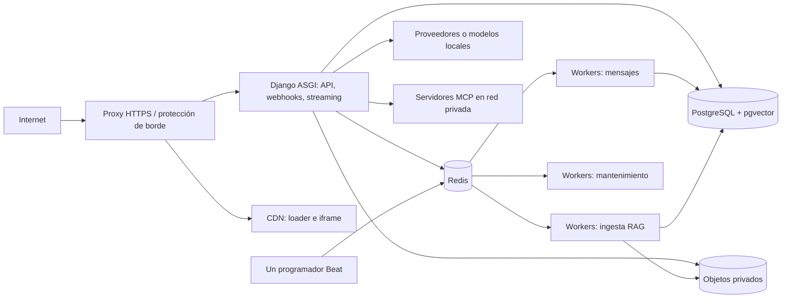

# Guía de despliegue del chatbot multicanal

**Documento base:** [Arquitectura del chatbot](arquitectura-chatbot.md), versión recibida el 13 de octubre de 2026.
**Alcance:** recomendaciones para pasar del diseño a un primer entorno de producción. No se ha inspeccionado código ni una infraestructura existente; los valores de capacidad, costes y tiempos de recuperación deben medirse y acordarse con los responsables.

## 1. Evaluación del diseño

La separación entre núcleo, canales, modelos, RAG y herramientas MCP es una base razonable. También conviene mantener desde el principio la resolución del cliente, la identidad verificada y la autorización fuera del modelo. El despliegue propuesto en la sección 15, sin embargo, enumera contenedores y réplicas sin definir límites de confianza, estados durables, recuperación ni criterios para abrir el servicio al público.

### Ajustes necesarios antes de producción

| Prioridad | Hallazgo en el documento | Guideline |
|---|---|---|
| Bloqueante | La sección 4.2 afirma que un esquema por cliente impide acceder a otro incluso ante un error de código. | Tratar `django-tenants` y `search_path` como separación lógica. Si el rol de aplicación puede leer todos los esquemas, un error de consulta aún puede cruzarlos. Probar permisos reales, SQL explícito, conexiones reutilizadas y rutas asíncronas. Para clientes que requieran una barrera de datos más fuerte, evaluar base de datos o instancia dedicada con credenciales separadas. |
| Bloqueante | La protección del widget se apoya en `Origin`, clave pública y token corto. | `Origin` y la clave pública sirven como señales de política y fricción contra abuso, pero no autentican a un visitante ni impiden clientes programáticos. Hacer cumplir cuotas y presupuesto en el servidor; limitar el token a cliente, sitio, sesión, alcance y caducidad. |
| Bloqueante | El webhook “guarda y responde 200; luego encola”. | Definir un punto de confirmación durable: verificar firma, deduplicar y persistir el evento en una transacción; publicar el trabajo con patrón outbox o reconciliación equivalente. Responder éxito solo después del commit. Una tarea puede repetirse, así que envío y efectos deben ser idempotentes. |
| Bloqueante | El borrado por cliente incluye copias de seguridad. | Una copia compartida no permite asumir borrado selectivo inmediato. Acordar retención, ventanas de expiración, recuperación y eliminación verificable de claves y objetos. Documentar qué queda en backups durante el periodo contractual. |
| Alta | No se fija el comportamiento ante caída del modelo, Redis, PostgreSQL o MCP. | Definir timeout, cancelación, reintento, respuesta al usuario y reconciliación para cada dependencia. El fallback de modelo exige una política explícita de residencia y privacidad; no enviar datos a un proveedor distinto por defecto. |
| Alta | La ingesta RAG propone HNSW y tamaños de fragmento fijos. | Considerarlos hipótesis iniciales. Medir calidad por cliente y tipo de documento, planes de consulta y latencia. Para corpus pequeños, comparar búsqueda exacta antes de mantener un índice HNSW por esquema. |
| Alta | Celery comparte trabajos de ingesta, webhooks y mantenimiento. | Usar colas y pools separados para que un PDF pesado no retrase mensajes. Establecer límites de memoria, tiempo, reintentos y concurrencia por tipo de trabajo y por cliente. |

## 2. Topología inicial recomendada

Mantener un único backend Django modular y desplegar por separado los procesos que tienen perfiles de carga distintos. Para el MVP, elegir servicios gestionados para PostgreSQL, Redis y almacenamiento de objetos cuando el proveedor y los requisitos de residencia lo permitan; esto reduce tareas operativas, pero no elimina la obligación de probar restauración y aislamiento.



- Publicar únicamente HTTPS del proxy, API/webhooks y activos del widget. PostgreSQL, Redis, MCP y modelos locales quedan en red privada, con reglas de salida mínimas.
- Separar en redes y credenciales las funciones de API, worker, migraciones y administración. El proceso que sirve tráfico no necesita privilegios DDL.
- Ejecutar varias réplicas de ASGI según pruebas de streaming; controlar conexiones a PostgreSQL y Redis por réplica. Configurar drenaje de conexiones y cierre ordenado durante despliegues.
- Usar almacenamiento de objetos privado para originales y derivados de documentos, con rutas y políticas por cliente. Redis es caché y broker, no fuente de verdad.
- Servir `loader.js` y el iframe desde dominios propios versionados. Fijar política de caché, integridad de artefactos y un procedimiento de reversión del widget.
- Poner una sola instancia activa de Beat y hacer que sus tareas toleren ejecución duplicada.

## 3. Decisiones que hay que cerrar antes de provisionar

| Decisión | Criterio y responsable sugerido |
|---|---|
| Región, proveedor y residencia de datos | Producto, seguridad y cliente: región de datos, backups, logs, proveedores LLM/embeddings y tráfico MCP. |
| Nivel de aislamiento contratado | Arquitectura y seguridad: esquema compartido para el nivel estándar o base/instancia dedicada cuando el riesgo contractual lo exija. Registrar el alcance de cada opción. |
| SSE o WebSocket | Backend y frontend: probar primero SSE si solo se transmiten tokens del servidor al navegador; elegir WebSocket si hay necesidad bidireccional real. Validar reconexión, autenticación y comportamiento del proxy. |
| Modelo y embeddings del MVP | Equipo IA: compatibilidad de streaming, herramientas, residencia, calidad, latencia y coste en un corpus de muestra. Versionar la elección por base de conocimiento. |
| Objetivos de servicio | Operaciones y negocio: disponibilidad, latencia de primer token y respuesta completa, recuperación (RTO/RPO), retención y volumen esperado. Sin estos datos no existe un número defendible de réplicas. |
| Alta de canales | Integraciones: para cada cliente, propiedad de bot/número, secreto, verificación, rotación, límites externos y proceso de baja. |

## 4. Secuencia de implementación y despliegue

### Etapa A: base reproducible

1. Crear repositorios o módulos para backend, widget e implementaciones MCP, con contratos internos versionados. Construir imágenes inmutables desde versiones fijadas y registrar su procedencia.
2. Definir infraestructura como código para red, certificados, DNS, base de datos, Redis, almacenamiento, gestores de secretos, métricas y alertas. Separar desarrollo, preproducción y producción; no reutilizar secretos ni datos de clientes.
3. Establecer configuración por entorno y por cliente. Los secretos viven en un gestor de secretos; la base de datos guarda referencias o valores cifrados con una jerarquía de claves y rotación documentada.
4. Automatizar compilación, análisis de dependencias, pruebas, publicación de imágenes y despliegue. Ejecutar migraciones como tarea controlada, antes de exponer nuevas instancias al tráfico.

### Etapa B: datos y clientes

1. Crear el esquema `public` mínimo y el flujo de alta de cliente con estado `provisionando → listo → suspendido → eliminado`. La operación debe poder reintentarse sin crear datos duplicados.
2. Activar pgvector, crear esquemas y aplicar migraciones de forma acotada; registrar éxito o error por cliente. Probar una migración con varios esquemas y una reversión compatible antes de añadir clientes reales.
3. Resolver cliente en el borde de cada petición y volver a validarlo dentro del servicio. En Celery, incluir un identificador de cliente firmado o validado, activar el contexto solo durante la tarea y restaurarlo al salir. No aceptar nombres de esquema aportados por el visitante.
4. Probar consultas cruzadas, SQL con nombre de esquema explícito, conexiones recicladas, tareas concurrentes, caché y rutas de administración. Retirar privilegios `CREATE` innecesarios y revisar el `search_path` y los permisos efectivos del rol de producción.
5. Preparar backups cifrados, restauración por entorno y un ejercicio de recuperación. Ensayar también la baja de un cliente, incluidos objetos, credenciales, índice, registros y la retención residual en copias compartidas.

### Etapa C: conversación y canales

1. Desplegar la API ASGI con límites de tiempo y tamaño de petición, métricas de conexiones abiertas y cancelación cuando el visitante cierre el chat. Evitar llamadas bloqueantes dentro de rutas asíncronas.
2. Definir estados durables del turno (`recibido`, `procesando`, `respuesta preparada`, `enviado`, `fallido`) e identificadores de idempotencia por evento, mensaje y llamada de herramienta.
3. Para webhooks: verificar autenticidad y tamaño del cuerpo, persistir evento único, confirmar, procesar en cola de mensajes y registrar el identificador de envío externo. Reintentar errores transitorios con espera creciente; llevar fallos permanentes a revisión.
4. Para el widget: validar origen permitido, CORS y `postMessage` con origen exacto; emitir token breve ligado al sitio y sesión; aplicar cuotas del lado servidor. Una identidad de usuario solo es válida si la firma procede del servidor del cliente.
5. Mantener MCP en red interna y aplicar permisos en código por cliente, usuario y canal. El backend aporta identidad verificada fuera de los argumentos del modelo. Registrar parámetros sensibles con redacción. Las herramientas de escritura esperan una confirmación que vincule usuario, acción y parámetros concretos.

### Etapa D: RAG

1. Ingerir documentos en una cola separada con antivirus o análisis de archivos, límites de tamaño, tipo y páginas, OCR acotado, estado visible y cuarentena de fallos.
2. Versionar extractor, limpieza, troceado, modelo de embeddings y documento. Hacer reindexaciones en un índice o versión nueva y conmutar después de validar; conservar la versión anterior para revertir.
3. Evaluar con preguntas y fuentes esperadas por cliente o dominio. Medir recuperación, citas correctas, ausencia de respuesta cuando no hay evidencia, latencia y coste. Los 300–800 tokens y 3–5 resultados del diseño son parámetros iniciales, no umbrales de aceptación.
4. Verificar que documentos y resultados de herramientas se traten como contenido no confiable. Ningún texto recuperado puede conceder permisos ni cambiar el cliente activo.

### Etapa E: preproducción y salida gradual

1. Ejecutar pruebas con dos o más clientes ficticios: acceso cruzado, claves de widget cambiadas, canales cruzados, caída de workers, duplicados, desconexión de streaming y fallo de proveedor.
2. Ejecutar carga representativa con mezcla de streaming, Telegram, ingesta y un cliente con ráfagas. Registrar distribución por cliente, conexiones, CPU/memoria, base de datos, cola, latencia, errores y coste. Completar una prueba sostenida para detectar fugas y acumulación de trabajo.
3. Restaurar una copia en preproducción, medir tiempos reales y verificar integridad de documentos, índices y mensajes. Abrir producción primero a un cliente piloto con límites conservadores; ampliar según métricas y resultados.

## 5. Controles operativos mínimos

| Área | Señales y acción |
|---|---|
| API y streaming | Tasa de errores, latencia de primer token y total, sesiones abiertas, cancelaciones, timeouts y saturación. Reducir admisión o ampliar ASGI según la dependencia limitante. |
| Colas | Antigüedad del mensaje más viejo, profundidad, reintentos, tareas fallidas, tiempo por tipo y cliente. Separar capacidad y revisar tareas atascadas. |
| PostgreSQL/pgvector | Conexiones, CPU, almacenamiento, espera de consultas, latencia de búsqueda, crecimiento por esquema y duración de migraciones. Revisar planes e índices con datos reales. |
| Redis | Memoria, expulsiones, latencia, disponibilidad y tamaño de colas. Definir comportamiento cuando falla el rate limiting; la política segura no debe permitir gasto ilimitado. |
| Modelos y MCP | Errores, timeouts, tokens, coste por mensaje y cliente, llamadas a herramientas, confirmaciones y bloqueos de política. Activar límites de gasto y alertas por anomalía. |
| Seguridad | Intentos de acceso cruzado, firmas inválidas, abuso por IP/sitio, cambios de secretos y accesos administrativos. Evitar contenido de conversaciones en logs técnicos. |

Definir presupuesto y cuotas por cliente para mensajes, tokens, concurrencia, documentos, ingesta y herramientas. Especificar qué ocurre al llegar a alerta, límite flexible y límite duro: aviso, reducción de capacidad o rechazo claro. Separar coste base de plataforma del coste variable por cliente; medir la distribución y los clientes de consumo excepcional en lugar de usar solo un promedio global.

## 6. Criterios de aceptación antes del primer cliente real

- [ ] Aislamiento validado con pruebas automatizadas y revisión de permisos de PostgreSQL, Redis, objetos, logs, tareas y MCP.
- [ ] Claves y secretos fuera del repositorio; rotación y revocación ensayadas.
- [ ] Webhooks idempotentes y recuperables tras interrupción entre persistencia y encolado.
- [ ] Restauración de backup probada y RTO/RPO medidos frente a objetivos acordados.
- [ ] Políticas de retención, residencia, proveedor de modelos y tratamiento de backups aprobadas para el piloto.
- [ ] Pruebas de carga y sostenidas con mezcla de clientes y trabajos; capacidad inicial justificada por resultados.
- [ ] Evaluación RAG y MCP con corpus y casos reales del piloto; ningún resultado fuera de permisos.
- [ ] Alertas, responsables de atención, procedimiento de incidentes y reversión de backend/widget ensayados.
- [ ] Límite de gasto, cuotas y comportamiento al agotarse definidos y visibles para operaciones.

## 7. Plantilla de contenedores para desarrollo local

Este ejemplo supone un monorepo con `backend/manage.py`, un proyecto Django llamado `config`, `backend/pyproject.toml` y `backend/uv.lock`. Sustituir `config` por el nombre real del proyecto. `uv` resuelve e instala las dependencias; **Uvicorn** ejecuta Django ASGI. La plantilla levanta API ASGI, dos workers Celery, Beat, Redis y PostgreSQL con pgvector. **No incluye todavía las aplicaciones, modelos ni migraciones del chatbot**: se aplica sobre un proyecto Django ya creado.

```text
chatbot/
├── compose.yaml
├── .env                 # local, fuera de Git
├── .env.example
└── backend/
    ├── Dockerfile
    ├── .dockerignore
    ├── pyproject.toml
    ├── uv.lock
    ├── manage.py
    └── config/
        ├── __init__.py
        ├── asgi.py
        ├── celery.py
        └── settings.py
```

### `backend/pyproject.toml` y `backend/uv.lock`

El backend es una aplicación Django con estructura plana, por lo que no necesita empaquetarse como librería Python. `uv` instalará sus dependencias y el código se importará desde `/app`:

```toml
[project]
name = "chatbot-backend"
version = "0.1.0"
requires-python = ">=3.12,<3.13"
dependencies = [
    "Django",
    "django-tenants",
    "psycopg[binary]",
    "pgvector",
    "celery",
    "redis",
    "uvicorn[standard]",
]

[dependency-groups]
dev = [
    "pytest",
    "pytest-django",
]
```

Las dependencias adicionales del chatbot (extracción de documentos, SDK de modelos, MCP, etc.) se añaden cuando se implementen sus módulos. Ejecutar `uv lock` dentro de `backend/` para generar `uv.lock`; guardar **ambos archivos** en Git. El lock fija las versiones resueltas, mientras que `pyproject.toml` declara los requisitos. Añadir restricciones de versión cuando las pruebas de compatibilidad lo requieran y actualizar el lock mediante un cambio revisado. En la máquina de desarrollo, `uv sync` instala también el grupo `dev` y `uv run pytest` ejecuta las pruebas; la imagen del servicio instala únicamente las dependencias de ejecución.

### `backend/Dockerfile`

```dockerfile
FROM python:3.12-slim
COPY --from=ghcr.io/astral-sh/uv:0.13.1 /uv /uvx /bin/

ENV PYTHONDONTWRITEBYTECODE=1 \
    PYTHONUNBUFFERED=1 \
    UV_PYTHON_DOWNLOADS=0 \
    UV_PROJECT_ENVIRONMENT=/opt/venv \
    PATH="/opt/venv/bin:$PATH"

WORKDIR /app

# El lock permite un build reproducible y esta capa se reutiliza al cambiar código.
COPY pyproject.toml uv.lock ./
RUN uv sync --locked --no-dev

COPY . /app

EXPOSE 8000
CMD ["uvicorn", "config.asgi:application", "--host", "0.0.0.0", "--port", "8000"]
```

La imagen instala las dependencias en `/opt/venv`: así el montaje de `./backend:/app` en desarrollo no oculta el entorno virtual. `--locked` hace fallar el build si `pyproject.toml` y `uv.lock` no concuerdan; `--no-dev` excluye herramientas de desarrollo. En producción, fijar también las imágenes base por digest y revisar la versión de `uv` al actualizarla.

### `backend/.dockerignore`

```text
.git
.venv
.pytest_cache/
.ruff_cache/
__pycache__/
*.pyc
.env
media/
staticfiles/
```

### `.env.example`

```dotenv
POSTGRES_DB=chatbot
POSTGRES_USER=chatbot
POSTGRES_PASSWORD=cambiar-para-desarrollo
DJANGO_SECRET_KEY=cambiar-por-un-valor-aleatorio-largo
DJANGO_DEBUG=1
DJANGO_ALLOWED_HOSTS=localhost,127.0.0.1
```

Copiar a `.env`, cambiar ambos secretos y excluir `.env` de Git. Estas credenciales son solo para desarrollo local.

### `compose.yaml`

```yaml
name: chatbot

x-backend: &backend
  build:
    context: ./backend
  env_file: .env
  environment:
    DB_HOST: db
    DB_PORT: "5432"
    DB_NAME: ${POSTGRES_DB}
    DB_USER: ${POSTGRES_USER}
    DB_PASSWORD: ${POSTGRES_PASSWORD}
    CELERY_BROKER_URL: redis://redis:6379/0
    CACHE_URL: redis://redis:6379/2
  volumes:
    - ./backend:/app
  depends_on:
    db:
      condition: service_healthy
    redis:
      condition: service_healthy

services:
  db:
    image: pgvector/pgvector:pg17
    environment:
      POSTGRES_DB: ${POSTGRES_DB}
      POSTGRES_USER: ${POSTGRES_USER}
      POSTGRES_PASSWORD: ${POSTGRES_PASSWORD}
    volumes:
      - postgres_data:/var/lib/postgresql/data
    healthcheck:
      test: ["CMD-SHELL", "pg_isready -U \"$$POSTGRES_USER\" -d \"$$POSTGRES_DB\""]
      interval: 5s
      timeout: 3s
      retries: 10

  redis:
    image: redis:7-alpine
    command: ["redis-server", "--appendonly", "yes"]
    volumes:
      - redis_data:/data
    healthcheck:
      test: ["CMD", "redis-cli", "ping"]
      interval: 5s
      timeout: 3s
      retries: 10

  web:
    <<: *backend
    command: uvicorn config.asgi:application --host 0.0.0.0 --port 8000 --reload
    ports:
      - "127.0.0.1:8000:8000"

  worker_messages:
    <<: *backend
    command: celery -A config worker --loglevel=INFO --queues=messages --concurrency=2

  worker_ingest:
    <<: *backend
    command: celery -A config worker --loglevel=INFO --queues=ingest --concurrency=1

  beat:
    <<: *backend
    command: celery -A config beat --loglevel=INFO

volumes:
  postgres_data:
  redis_data:
```

El `compose.yaml` real del repositorio difiere de esta plantilla: tiene un solo `worker` para la cola `messages`, que también procesa la ingesta, y un servicio opcional `baileys`. Separar `worker_ingest` sigue pendiente (ver [Pendientes](pendientes.md)).

La API es el único servicio expuesto al equipo local; DB y Redis solo son accesibles entre contenedores. `depends_on: service_healthy` espera disponibilidad básica, pero **no ejecuta migraciones**. El volumen de código y `--reload` son comodidades de desarrollo.

### `backend/config/asgi.py` y streaming

Con la opción SSE del widget, `asgi.py` puede ser el archivo estándar de Django:

```python
import os

from django.core.asgi import get_asgi_application

os.environ.setdefault("DJANGO_SETTINGS_MODULE", "config.settings")

application = get_asgi_application()
```

Uvicorn carga `config.asgi:application`. Ese objeto recibe las peticiones HTTP y las entrega a Django; las URLs deciden qué vista atiende cada petición. Por ello, la vista del chat puede devolver una respuesta en streaming mediante SSE sin añadir rutas especiales a `asgi.py`. También pasan por este punto los webhooks, el panel y las rutas HTTP normales. Celery y Beat son procesos independientes y no usan `asgi.py`.

Solo si se eligen WebSockets hace falta incorporar Django Channels y un enrutador de protocolo para el tráfico `websocket`; entonces se añaden rutas de consumidores, autenticación y validación del origen. Para el MVP con SSE, mantener el archivo mínimo evita esa complejidad.

### Integración mínima de Celery con Django

En `backend/config/celery.py`:

```python
import os
from celery import Celery

os.environ.setdefault("DJANGO_SETTINGS_MODULE", "config.settings")

app = Celery("config")
app.config_from_object("django.conf:settings", namespace="CELERY")
app.autodiscover_tasks()
```

En `backend/config/__init__.py`:

```python
from .celery import app as celery_app

__all__ = ("celery_app",)
```

En `settings.py`, configurar el backend de base de datos de `django-tenants` junto con sus modelos, router y middleware según el proyecto; el siguiente fragmento solo muestra las conexiones necesarias para Compose:

```python
import os

SECRET_KEY = os.environ["DJANGO_SECRET_KEY"]
DEBUG = os.environ.get("DJANGO_DEBUG") == "1"
ALLOWED_HOSTS = os.environ.get("DJANGO_ALLOWED_HOSTS", "").split(",")

DATABASES = {
    "default": {
        "ENGINE": "django_tenants.postgresql_backend",
        "NAME": os.environ["DB_NAME"],
        "USER": os.environ["DB_USER"],
        "PASSWORD": os.environ["DB_PASSWORD"],
        "HOST": os.environ["DB_HOST"],
        "PORT": os.environ.get("DB_PORT", "5432"),
    }
}

CACHES = {
    "default": {
        "BACKEND": "django.core.cache.backends.redis.RedisCache",
        "LOCATION": os.environ["CACHE_URL"],
    }
}

CELERY_BROKER_URL = os.environ["CELERY_BROKER_URL"]
CELERY_TASK_DEFAULT_QUEUE = "messages"
CELERY_TASK_ROUTES = {
    "chatbot.tasks.process_channel_message": {"queue": "messages"},
    "knowledge.tasks.ingest_document": {"queue": "ingest"},
}
```

Los nombres de tareas son ejemplos: cambiarlos por las rutas reales. Toda tarea que acceda a datos de un cliente debe recibir un identificador de cliente validado y activar `tenant_context` durante su ejecución. Si se usa `django-tenants`, completar también `SHARED_APPS`, `TENANT_APPS`, `TENANT_MODEL`, `TENANT_DOMAIN_MODEL`, `DATABASE_ROUTERS` y `TenantMainMiddleware`; no basta con cambiar `ENGINE`.

### Arranque local

Desde la raíz del monorepo:

```powershell
Copy-Item .env.example .env
# Editar .env y sustituir los secretos de ejemplo.
Push-Location backend
uv lock
uv lock --check
Pop-Location
docker compose build
docker compose up -d db redis
docker compose exec db psql -U chatbot -d chatbot -c "CREATE EXTENSION IF NOT EXISTS vector;"
docker compose run --rm web python manage.py migrate_schemas --shared
docker compose run --rm web python manage.py migrate_schemas
docker compose up -d web worker_messages worker_ingest beat
docker compose ps
```

Si se cambian `POSTGRES_USER` o `POSTGRES_DB` en `.env`, usar esos valores también en el comando `psql`. La extensión debe habilitarse una vez en la base; conviene incorporarla después a una migración controlada. Crear el cliente público y sus dominios según los modelos concretos del proyecto antes de probar el widget. En `localhost`, `django-tenants` necesita que el dominio solicitado resuelva al esquema previsto. Tras cambiar dependencias con `uv add` o `uv remove` dentro de `backend/`, guardar el nuevo `uv.lock` y reconstruir las imágenes.

## 8. Cambios necesarios para preproducción y producción

- Construir la imagen sin montar `./backend`, sin `--reload` y con `uv sync --locked --no-dev`. Ejecutar con usuario sin privilegios y revisar tamaño, vulnerabilidades y procedencia de la imagen.
- Configurar `DJANGO_DEBUG=0`, `ALLOWED_HOSTS`, HTTPS y secretos reales. Usar un proxy o balanceador delante de ASGI; definir buffering, timeouts y cierre ordenado para streaming.
- Ejecutar migraciones como paso controlado del despliegue, no al arrancar cada réplica. Probarlas con múltiples esquemas y hacer cambios compatibles entre versión antigua y nueva.
- Usar PostgreSQL y Redis gestionados o instancias operadas con backups, monitoreo y recuperación probada. No publicar sus puertos en internet. Guardar originales RAG en almacenamiento de objetos privado, no en el volumen del contenedor.
- Mantener una sola instancia activa de Beat. Dimensionar API y workers por separado según carga observada; la ingesta no debe bloquear la cola de mensajes.
- Definir límites de CPU/memoria, escalado, logs, métricas, alertas, cuotas por cliente y pruebas de restauración antes de admitir datos reales.

## 9. Fuentes técnicas consultadas

Estas fuentes respaldan los matices de implementación; los requisitos de negocio y las decisiones abiertas proceden del documento base.

- [PostgreSQL: esquemas y `search_path`](https://www.postgresql.org/docs/current/ddl-schemas.html): los esquemas no son barreras rígidas si el rol conserva privilegios sobre otros.
- [django-tenants: contextos de esquema](https://django-tenants.readthedocs.io/en/stable/use.html): activación y restauración explícita del contexto de cliente.
- [Celery: tareas e idempotencia](https://docs.celeryq.dev/en/stable/userguide/tasks.html): los reintentos y acuses tardíos requieren tareas idempotentes.
- [pgvector: índices y filtrado](https://github.com/pgvector/pgvector/blob/master/README.md): el índice aproximado y los filtros requieren validación de calidad y rendimiento.
- [Django: despliegue ASGI](https://docs.djangoproject.com/en/stable/howto/deployment/asgi/): ejecución de Django en un servidor ASGI.
- [Celery: integración con Django](https://docs.celeryq.dev/en/stable/django/first-steps-with-django.html): patrón de configuración del módulo `celery.py`.
- [Docker Compose: servicios y dependencias](https://docs.docker.com/reference/compose-file/services/): espera de servicios marcados como saludables.
- [uv: proyectos y lockfile](https://docs.astral.sh/uv/concepts/projects/sync/): sincronización reproducible con `pyproject.toml` y `uv.lock`.
- [uv: uso en Docker](https://docs.astral.sh/uv/guides/integration/docker/): instalación de `uv`, caché de dependencias y sincronización dentro de imágenes.
